  

  Criador de conteúdo e desenvolvedor

  

---

## 📊 Estatísticas

  <picture>
    <source media="(prefers-color-scheme: dark)" srcset="https://raw.githubusercontent.com/abel-odorico/abelodorico/cards/summary-dark.svg">
    
  </picture>
  <picture>
    <source media="(prefers-color-scheme: dark)" srcset="https://raw.githubusercontent.com/abel-odorico/abelodorico/cards/languages-dark.svg">
    
  </picture>

  <picture>
    <source media="(prefers-color-scheme: dark)" srcset="https://raw.githubusercontent.com/abel-odorico/abelodorico/cards/contributions-dark.svg">
    
  </picture>
  <picture>
    <source media="(prefers-color-scheme: dark)" srcset="https://raw.githubusercontent.com/abel-odorico/abelodorico/cards/weekly-dark.svg">
    
  </picture>

  <picture>
    <source media="(prefers-color-scheme: dark)" srcset="https://raw.githubusercontent.com/abel-odorico/abelodorico/cards/streaks-dark.svg">
    
  </picture>

