<h1 align="center">Olá, eu sou o Abel Odorico 👋</h1>

  Criador de conteúdo e desenvolvedor — <b>Além do Alcance</b> · Peep Studio

  

---

## 📊 Estatísticas

  <picture>
    <source media="(prefers-color-scheme: dark)" srcset="https://raw.githubusercontent.com/abel-odorico/abelodorico/cards/summary-dark.svg">
    
  </picture>
  <picture>
    <source media="(prefers-color-scheme: dark)" srcset="https://raw.githubusercontent.com/abel-odorico/abelodorico/cards/languages-dark.svg">
    
  </picture>

  <picture>
    <source media="(prefers-color-scheme: dark)" srcset="https://raw.githubusercontent.com/abel-odorico/abelodorico/cards/contributions-dark.svg">
    
  </picture>
  <picture>
    <source media="(prefers-color-scheme: dark)" srcset="https://raw.githubusercontent.com/abel-odorico/abelodorico/cards/weekly-dark.svg">
    
  </picture>

  <picture>
    <source media="(prefers-color-scheme: dark)" srcset="https://raw.githubusercontent.com/abel-odorico/abelodorico/cards/streaks-dark.svg">
    
  </picture>

